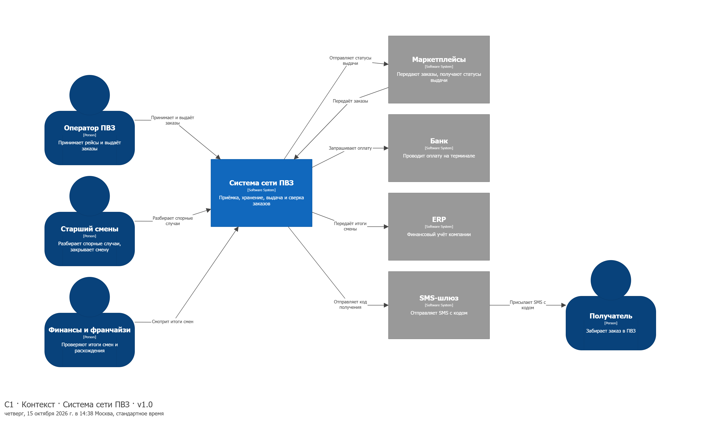
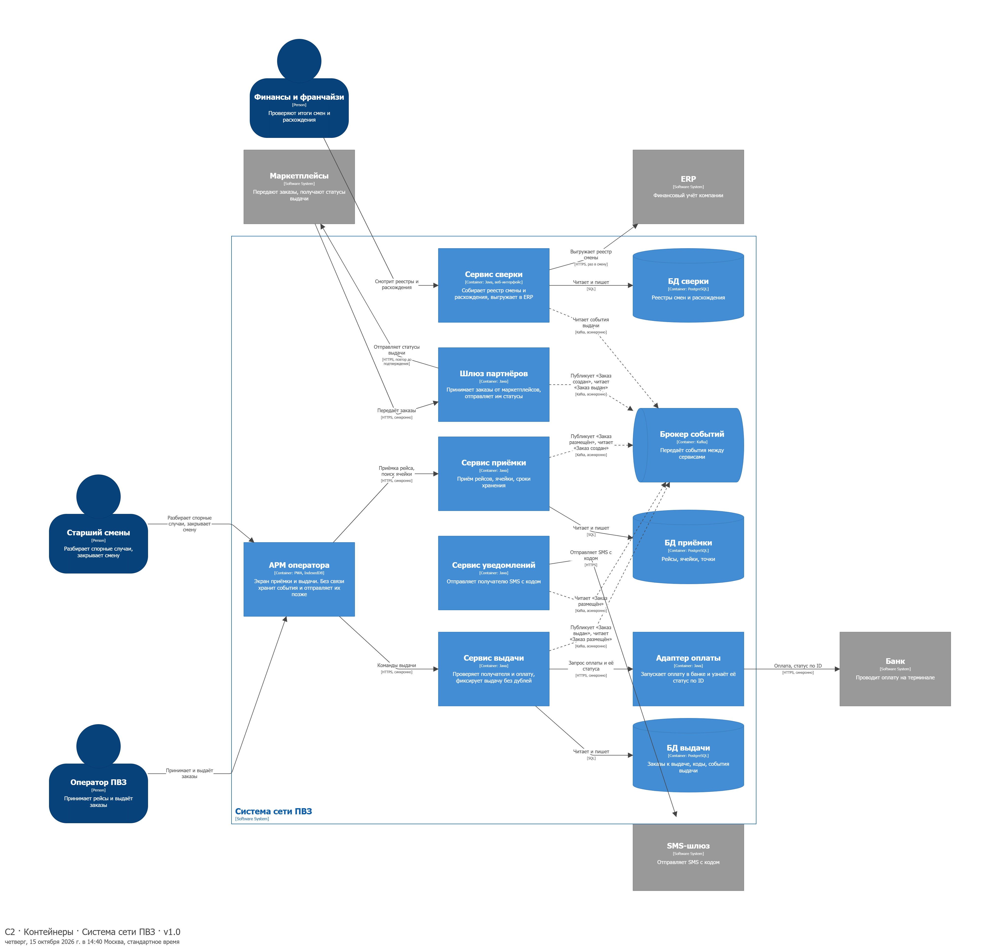
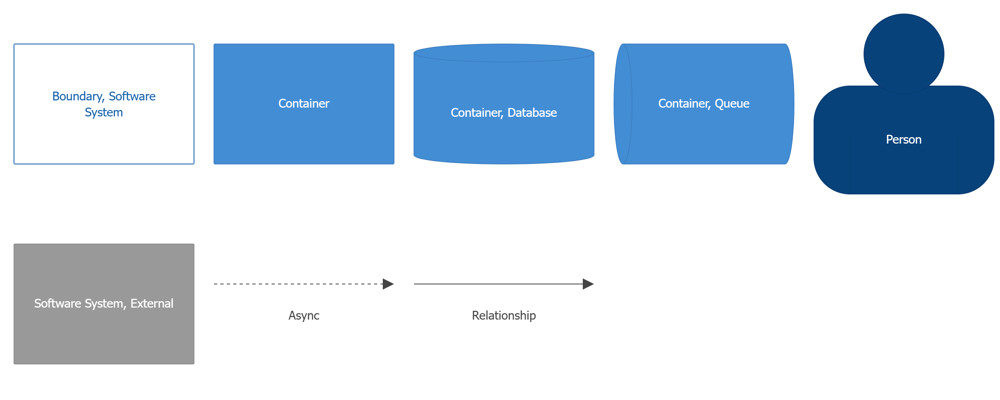

# Архитектура: контексты, C4 и владение

Сценарий: выдача заказа с оплатой при получении.

Главный драйвер архитектуры — NFR-02: точка работает до 4 часов без связи, и события выдачи не теряются.

## 1. Event Storming

Выписали события ключевого сценария по порядку и сгруппировали их.

| № | Событие | Кто делает | Группа |
|---|---|---|---|
| 1 | Заказ создан | Маркетплейс | Партнёры |
| 2 | Рейс принят на точке | Оператор | Приёмка |
| 3 | Заказ размещён в ячейке | Оператор | Приёмка |
| 4 | SMS с кодом отправлено | Система | Приёмка |
| 5 | Получатель проверен | Оператор | Выдача |
| 6 | Оплата запрошена | Оператор | Оплата |
| 7 | Оплата подтверждена / отклонена / не определена | Банк | Оплата |
| 8 | Заказ выдан | Оператор | Выдача |
| 9 | Статус выдачи отправлен маркетплейсу | Система | Партнёры |
| 10 | Смена закрыта | Старший смены | Сверка |
| 11 | Реестр смены выгружен в ERP | Система | Сверка |

**Горячие точки:** событие 7 (ответ банка не пришёл) и событие 9 (статус не дошёл до маркетплейса). 

## 2. Контексты

| Контекст | Тип | Что делает | Владелец |
|---|---|---|---|
| Выдача | Основной | Проверяет получателя и оплату, фиксирует выдачу, работает без связи | Руководитель сети ПВЗ |
| Оплата | Типовой | Запускает оплату в банке и узнаёт её статус | Финансовый директор |
| Приёмка и хранение | Поддерживающий | Принимает рейсы, раскладывает заказы по ячейкам | Руководитель сети ПВЗ |
| Сверка | Поддерживающий | Собирает реестр смены и расхождения, выгружает в ERP | Финансовый директор |
| Партнёры | Поддерживающий | Принимает заказы от маркетплейсов и отправляет им статусы | Директор по партнёрским программам |

Выдача — основной контекст: от неё зависят деньги и клиенты. Оплату не пишем сами, а подключаем банк через адаптер.

## 3. Карта контекстов

| Откуда → Куда | Что передаётся | Тип отношения |
|---|---|---|
| Маркетплейсы → Партнёры | Заказы | Open Host Service: у нас один API для всех маркетплейсов |
| Партнёры → Маркетплейсы | Статусы выдачи | Conformist: отправляем статусы в формате маркетплейса |
| Партнёры → Приёмка | «Заказ создан» | Customer–Supplier |
| Приёмка → Выдача | «Заказ размещён» | Customer–Supplier |
| Оплата → Выдача | Статус оплаты: оплачено / отказ / не определено | Customer–Supplier |
| Оплата → Банк | Запрос оплаты | Anti-Corruption Layer: адаптер переводит ответы банка в наши три статуса |
| Выдача → Сверка | «Заказ выдан» | Customer–Supplier |
| Выдача → Партнёры | «Заказ выдан» | Customer–Supplier |
| Сверка → ERP | Реестр смены | Conformist: выгружаем в формате ERP |

## 4. Диаграммы C4

Обе диаграммы описаны кодом в [c4-workspace.dsl](./diagrams/c4-workspace.dsl). Открыть их можно на https://playground.structurizr.com/.

### C1 — контекст

### C2 — контейнеры

* Работа без связи (NFR-02) — это **АРМ оператора**: он хранит события в IndexedDB и отправляет их, когда связь вернётся.
* Защита от дублей (NFR-04) — **Сервис выдачи** не создаёт вторую выдачу с тем же ID.
* Медленный банк не тормозит выдачу: **Адаптер оплаты** ждёт ответ не дольше 2 секунд, потом показывает «Платёж не определён».
* У каждой БД один владелец. Циклов между сервисами нет: обратные данные идут событиями через брокер.

## 5. ADR Решения

* [ADR-001: архитектурный стиль](./adr/ADR-001-architecture-style.md)
* [ADR-002: база данных](./adr/ADR-002-database.md)
* [ADR-003: брокер сообщений](./adr/ADR-003-message-broker.md)