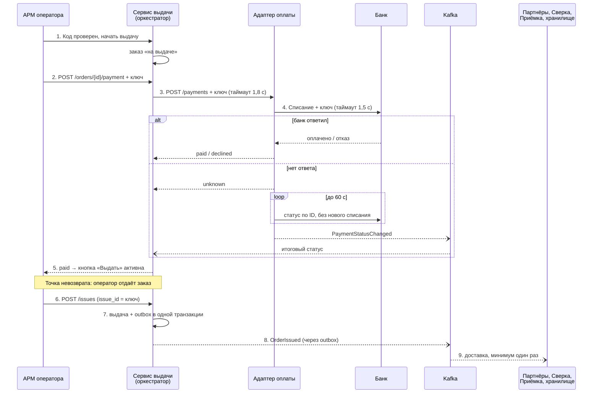

# Интеграции: контракты, сага и Outbox

Сценарий тот же: выдача заказа с оплатой при получении (НП). Каждая стрелка между контейнерами на [C2](./05-c4-and-adr.md) — это контракт с версией.

## 1. Карта интеграций

| Связь | Стиль | Контракт |
|---|---|---|
| АРМ → Сервис выдачи | Синхронно (REST), без связи — очередь в АРМ | [openapi/issue-api.yaml](../openapi/issue-api.yaml) |
| Сервис выдачи → Адаптер оплаты → Банк | Синхронно, с таймаутом | [openapi/payment-adapter-api.yaml](../openapi/payment-adapter-api.yaml) |
| Приёмка → Выдача, Уведомления, хранилище | Событие `OrderPlaced` | [asyncapi/intake-events.yaml](../asyncapi/intake-events.yaml) |
| Выдача → Партнёры, Сверка, Приёмка, хранилище | Событие `OrderIssued` | [asyncapi/issue-events.yaml](../asyncapi/issue-events.yaml) |
| Адаптер оплаты → Выдача, Сверка, хранилище | Событие `PaymentStatusChanged` | [asyncapi/payment-events.yaml](../asyncapi/payment-events.yaml) |
| Партнёры → Маркетплейс | Синхронно, повтор до подтверждения | API маркетплейса (Тема 2.4) |
| Сверка → ERP | Пакет раз в смену | Формат ERP (Тема 2.4) |

Синхронно делаем только оплату и выдачу: без ответа оператор не может сделать следующий шаг. Всё остальное идёт событиями, потому что потребителей много и ответ сразу не нужен.

## 2. Общие правила контрактов

* Изменяющие запросы (POST) идут с заголовком `Idempotency-Key`. Повтор с тем же ключом возвращает прежний результат и не создаёт вторую выдачу или второе списание.
* Ошибки в одном формате `application/problem+json` (RFC 7807) со своим кодом: `PAYMENT_UNKNOWN`, `ALREADY_ISSUED` и т. д.
* У оплаты три исхода: `paid`, `declined`, `unknown`. Незнакомый статус потребитель считает `unknown`.
* В каждом событии есть `event_id` (для отсева дублей), `event_type`, `event_version`, `occurred_at` (время факта, а не отправки) и `order_id` (ключ Kafka, чтобы события одного заказа шли по порядку).
* ПДн получателя в события не кладём.

## 3. Политика версий

Версия по схеме MAJOR.MINOR.PATCH. Мажорная версия есть в пути API (`/v1`) и в имени топика (`.v1`).

| Изменение | Совместимо? | Что делаем |
|---|---|---|
| Добавить необязательное поле | Да | MINOR, потребители игнорируют незнакомые поля |
| Добавить новое событие или метод | Да | MINOR, запись в журнале изменений |
| Добавить значение в `enum` | Осторожно | MINOR, только если потребители обрабатывают незнакомое значение |
| Сделать поле обязательным | Нет | Новая мажорная версия |
| Переименовать или удалить поле | Нет | Новая версия (`.v2`), старую поддерживаем 3 месяца |
| Поменять смысл поля (рубли → копейки) | Нет | Новое поле, старое не трогаем |

Изменения контрактов проходят ревью через pull request; ревьюер — команда-потребитель.

## 4. Сага «выдача с оплатой при получении»

Общей транзакции между Выдачей, Оплатой, банком и Kafka нет. Поэтому выдача — это сага: цепочка локальных шагов, где у шагов до точки невозврата есть компенсации. Ведёт сагу Сервис выдачи (оркестрация, [ADR-005](./adr/ADR-005-saga-style.md)).



Сплошная стрелка — синхронный вызов, пунктир — ответ или событие. Код схемы также лежит в [diagrams/saga-issue-payment.md](./diagrams/saga-issue-payment.md).

### Шаги и компенсации

| Шаг | Тип | Действие | Компенсация |
|---|---|---|---|
| 1. Заказ «на выдаче» | Компенсируемый | Заказ закреплён за окном | Снять закрепление |
| 2. Списание | Компенсируемый | Запрос в банк с ключом идемпотентности | Возврат платежа (`POST /payments/{id}/refunds`) |
| 3. Оплата подтверждена | Поворотный | Решение «выдавать» | — точка невозврата |
| 4. Передача заказа | Физический | Оператор отдаёт товар | Только процесс «возврат товара» |
| 5. Событие `OrderIssued` | Повторяемый | Публикация через outbox | Не нужна, повторяем до успеха |

Компенсация — это новое действие, а не откат: если деньги списали, а получатель отказался от заказа, делаем возврат, и он тоже остаётся в журнале.

### Если банк не ответил

1. Новое списание запускать нельзя: будет риск двойного списания (FR-05).
2. Адаптер спрашивает статус по ID операции через 2, 4, 8, 16, 30 с, всего до 60 с (Spike).
3. Если статус пришёл — сага идёт дальше. Если нет — АРМ показывает «Платёж не определён» (FR-02), выдача заблокирована, заказ уходит на разбор старшему смены.

## 5. Таймауты и повторы

| Вызов | Таймаут | Повторы |
|---|---|---|
| Адаптер → Банк (списание) | 1,5 с | Нет, после таймаута только запрос статуса |
| Адаптер → Банк (статус) | 1,5 с | 2, 4, 8, 16, 30 с + случайные 0–500 мс, всего до 60 с |
| Выдача → Адаптер | 1,8 с | Нет, бюджет NFR-01 — 2 с |
| АРМ → Выдача | 2,5 с | До 3 раз с тем же ключом: 0,5 / 1 / 2 с |
| Партнёры → Маркетплейс | 5 с | Пауза растёт до 10 мин, повторяем 24 ч, потом инцидент |

Повторяем только идемпотентные вызовы (с ключом). Пауза между повторами растёт и со случайной добавкой, чтобы все точки не повторяли одновременно. Circuit breaker — в Модуле 3.

## 6. Transactional Outbox

Проблема: если сначала записать выдачу в БД, а потом отправить событие в Kafka, сервис может упасть между этими шагами. Выдача будет, а маркетплейс о ней не узнает.

Решение: выдача и событие записываются в одной транзакции. Событие кладём в таблицу `outbox` в той же БД выдачи:

```sql
BEGIN;
INSERT INTO issue (issue_id, order_id, payment_id, operator_id, point_id, occurred_at)
VALUES (...);                                  -- UNIQUE(order_id): DQ-02
INSERT INTO outbox (event_id, topic, msg_key, payload, created_at)
VALUES (gen_random_uuid(), 'pvz.issue.order-issued.v1', '4821-77', '{...}', now());
COMMIT;
```

Ретранслятор раз в секунду читает строки `outbox` без отметки «отправлено», публикует их в Kafka и ставит отметку. Выбрали опрос таблицы (polling), а не CDC: поток умеренный, так проще. Если задержка станет важнее, перейдём на CDC (Debezium).

Событие появится тогда и только тогда, когда выдача сохранена. Цена — возможные дубли: ретранслятор мог отправить событие и упасть до отметки. Поэтому потребители должны отсеивать повторы.

Так же через outbox публикуются `PaymentStatusChanged` (БД оплаты) и `OrderPlaced` (БД приёмки).

## 7. Идемпотентный приём `OrderIssued` (Сверка)

Kafka доставляет событие минимум один раз (at-least-once). Сверка обрабатывает его так:

1. Получить событие.
2. В одной транзакции: записать `event_id` в таблицу `processed_event` и добавить выдачу в реестр смены.
3. Если такой `event_id` уже есть — это повтор, ничего не делаем.
4. После коммита подтвердить Kafka (commit offset).

```sql
BEGIN;
INSERT INTO processed_event (event_id, processed_at)
VALUES ('9a7c1e4f-...', now())
ON CONFLICT (event_id) DO NOTHING;             -- 0 строк = повтор, выходим
INSERT INTO shift_issue (order_id, shift_id, cod_amount_kopecks)
VALUES ('4821-77', ..., 249000)
ON CONFLICT (order_id) DO NOTHING;             -- ещё и защита по заказу
COMMIT;
```

Итог: доставка «минимум один раз» + идемпотентный приём = событие учитывается ровно один раз (effectively-once). Так же работают Партнёры (статус маркетплейсу) и хранилище (дедупликация в слое clean).

На стороне сервера повтор от АРМ после офлайна отсекается по `issue_id`: тот же ключ → ответ 200 с прежней выдачей (NFR-04).

## 8. Согласованность в конечном счёте

| Когда | Что |
|---|---|
| 0 с | Выдача записана в БД выдачи вместе с outbox |
| ≈ 1 с | Событие в Kafka |
| ≈ 3 с | Партнёры отправили статус маркетплейсу |
| ≤ 15 мин | Выдача в хранилище (DQ-04) |
| Конец смены | Реестр в ERP |
| После офлайна | До 4 ч + те же сроки (NFR-02, NFR-03) |

Сроки записаны в контрактах и проверяются правилами DQ.

## 9. Конфликты

| Ситуация | Правило | Что делаем |
|---|---|---|
| Заказ выдан офлайн, а покупатель успел его отменить | Физический факт важнее | Принимаем выдачу, маркетплейс оформляет возврат |
| Выдача с НП без связи | Запрещено (NFR-02) | АРМ не даёт выдать |
| Два АРМ выдали один заказ | Уникальность (DQ-02) | Второй запрос получает 409, инцидент |
| Срок хранения истёк, заказ ушёл на возврат, а потом пришла офлайн-выдача | Сравниваем `occurred_at` и время возврата | Конфликт уходит старшему смены |

## 10. ML-кандидат: прогноз загрузки точки

В To-be изменениях [Capability Passport](./02-capability-passport.md) есть «прогноз очереди в ПВЗ». Проверяем, нужен ли тут ML (машинное обучение).

| Критерий | Вопрос | Ответ для прогноза загрузки |
|---|---|---|
| Цена ошибки | Что будет при неверном прогнозе? | Невысокая: лишний или недостающий оператор на смене. Ошибку видно сразу |
| Данные | Есть ли история? | Будет: все выдачи по точкам и часам попадают в хранилище (ADR-004). Разметка не нужна |
| Простое правило | Насколько хорошо работает правило? | Правило: среднее за этот же час и день недели за прошлые 4 недели. Для обычных недель неплохо, но не учитывает распродажи и праздники |
| Объяснимость | Нужно ли объяснять решение? | Нет, это подсказка, а не юридически значимое решение |
| Дрейф | Меняется ли мир? | Да: сезонность, распродажи (11.11), новые маркетплейсы. Нужен мониторинг ошибки |
| Эксплуатация | Кто поддерживает? | Архитектор данных и аналитики, модель переобучается раз в неделю |

Решение: начинаем с правила как базовой линии. ML (градиентный бустинг) берём, когда в хранилище наберётся 6 месяцев истории и модель обгонит правило на 15% по MAPE (средняя ошибка прогноза в процентах) на реальных данных, а не на демо.

* **Человек в контуре (Human-in-the-loop):** прогноз только подсказывает. Руководитель точки сам решает, сколько операторов ставить, и может поправить план. Его правки сохраняем и используем для оценки модели.
* **Запасной вариант:** если модель недоступна или её ошибка выросла, показываем прогноз по правилу.
* **Контракт ответа:** точка, час, прогноз выдач, версия модели.

Что не отдаём ML: решение «оплата прошла / не прошла». Ошибка там необратима (выданный товар без денег), поэтому только ответ банка.

## Решения

* [ADR-005: стиль саги](./adr/ADR-005-saga-style.md)
