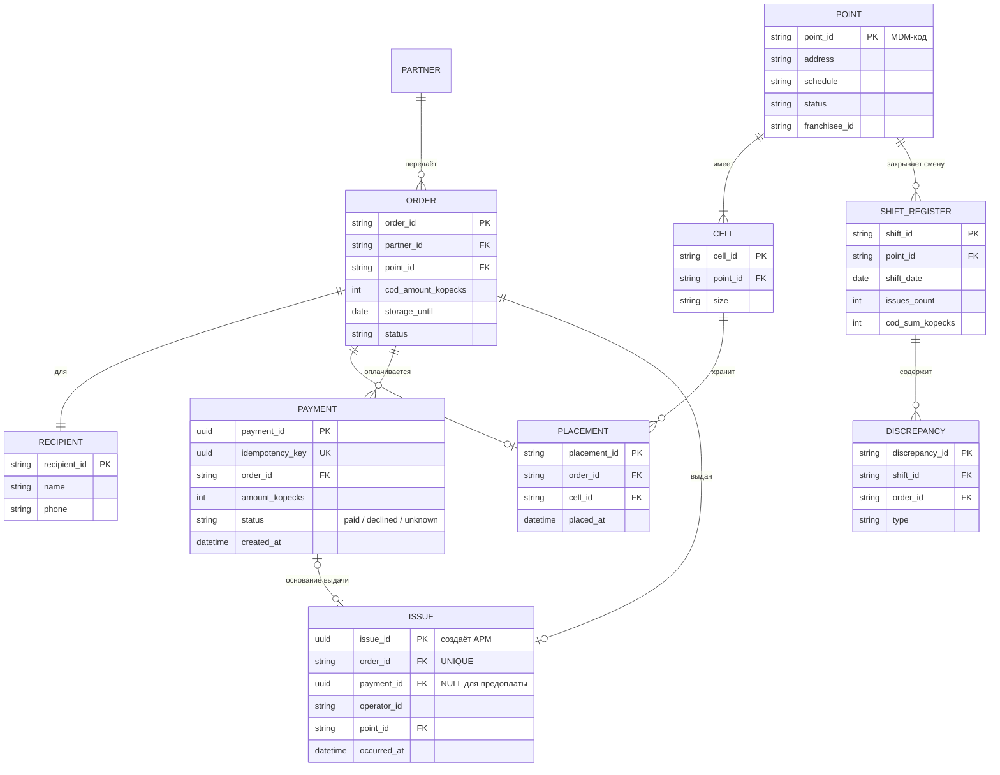
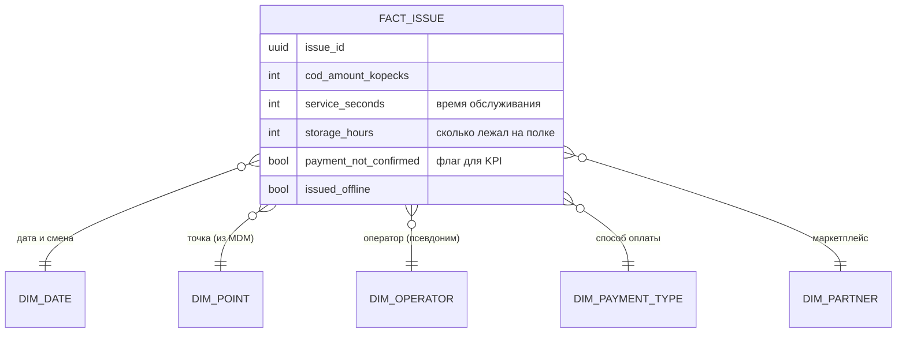
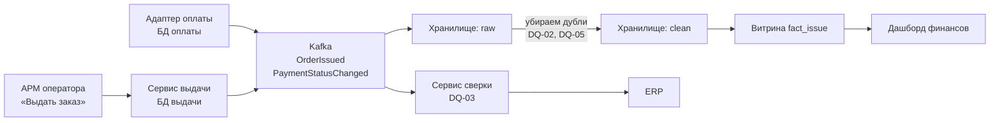

# Данные: модель, владение и качество

Сценарий: выдача заказа с оплатой при получении (НП), как в [C4 и ADR](../05-c4-and-adr.md).

У каждого факта один источник истины (System of Record, SoR). Только он создаёт и меняет данные, остальные получают копию через API или событие из Kafka.

## 1. Ключевые сущности

| № | Сущность | Что хранит | Источник (SoR) | Где лежит | Бизнес-владелец |
|---|---|---|---|---|---|
| E1 | Заказ | Номер, маркетплейс, сумма НП, срок хранения | Партнёры | Шлюз партнёров | Директор по партнёрским программам |
| E2 | Получатель | Имя и телефон (ПДн) | Партнёры | Шлюз партнёров | Директор по партнёрским программам |
| E3 | Размещение в ячейке | Точка, ячейка, время размещения | Приёмка | БД приёмки | Руководитель сети ПВЗ |
| E4 | Пункт выдачи и ячейки | Код, адрес, график, статус, франчайзи | Справочник точек | БД справочника | Руководитель сети ПВЗ |
| E5 | Платёжная операция | Запрос оплаты и итог: оплачено / отказ / не определено | Оплата | БД оплаты | Финансовый директор |
| E6 | Выдача | Кто, где, когда выдал и по какой оплате | Выдача | БД выдачи | Руководитель сети ПВЗ |
| E7 | Реестр смены | Итоги смены и расхождения | Сверка | БД сверки | Финансовый директор |

Состав заказа приходит от маркетплейса, мы храним копию и его не меняем.

### Логическая модель

* `order_id` в выдаче уникальный: один заказ нельзя выдать дважды (NFR-04).
* `issue_id` создаёт АРМ на точке (FR-03), поэтому повторная отправка после офлайна не создаёт новую выдачу.
* Деньги храним в копейках, чтобы не было ошибок округления.

## 2. Матрица CRUD

C — создаёт, R — читает, U — меняет, D — удаляет, * — владелец.

| Сущность | Партнёры | Приёмка | Выдача | Оплата | Сверка | Справочник точек | Хранилище |
|---|---|---|---|---|---|---|---|
| E1 Заказ | CRU* | R | R | — | R | — | R |
| E2 Получатель | CRU* | — | R (маска) | — | — | — | псевдоним |
| E3 Размещение | — | CRUD* | R | — | — | — | R |
| E4 Точки и ячейки | R | R | R | R | R | CRUD* | R |
| E5 Платёжная операция | — | — | R | CRU* | R | — | R |
| E6 Выдача | R | R | CR* | — | R | — | R |
| E7 Реестр смены | — | — | — | — | CRU* | — | R |

В каждой строке C/U есть только у одного контекста. Выдачу нельзя изменить: если выдали по ошибке, оформляется возврат.

Как читающие получают данные (контракты опишем в Теме 2.3):

| Кто читает | Что | Как |
|---|---|---|
| Приёмка, Выдача, Сверка | Заказ | Событие `OrderCreated` |
| Выдача | Размещение | Событие `OrderPlaced` |
| Выдача, Сверка | Оплата | API адаптера оплаты и событие `PaymentStatusChanged` |
| Партнёры, Приёмка, Сверка | Выдача | Событие `OrderIssued` |
| Все | Точки и ячейки | Событие `PointChanged` и API справочника |
| Хранилище | Всё, кроме ПДн | Подписка на события ([ADR-004](../adr/ADR-004-analytics-data-delivery.md)) |

ПДн: Выдача видит только маску телефона (`+7 *** ***-12-34`), в хранилище вместо получателя псевдоним (хеш).

### Роли

| Роль | Кто | Что делает |
|---|---|---|
| Владелец (Data Owner) | Бизнес-владельцы из таблицы E1–E7 | Решает, что значат данные и кому доступ |
| Стюард (Data Steward) | Архитектор данных и аналитики | Ведёт словарь данных и правила DQ |
| Хранитель (Custodian) | Команда сервиса | Хранение, бэкапы, права к БД |
| Потребитель (Consumer) | Сверка, хранилище, BI, ERP | Читает по контракту, у себя не правит |

## 3. Мастер-данные и MDM

Мастер-данные — справочник точек (ПВЗ, постаматы, ячейки, график, статус, франчайзи). Справочные данные — статусы оплаты, причины отказа, типы расхождений, они задаются как `enum` в контрактах.

Сейчас у одной точки три кода: в ERP, у маркетплейса и наш внутренний. Точку закрывают на ремонт, а маркетплейс ещё предлагает её покупателям.

| Стиль MDM | Берём? |
|---|---|
| Реестр | Нет, только видим дубли и ничего не исправляем |
| Консолидация | Да, этап 1: собираем данные из ERP, маркетплейсов и приёмки в одну золотую запись |
| Сосуществование | Нет, двусторонняя синхронизация с ERP и маркетплейсами даст конфликты |
| Централизованный | Да, этап 2: точки заводятся и меняются только в Справочнике точек, остальные получают `PointChanged` |

Справочник новый и у него один владелец (руководитель сети ПВЗ). Консолидация ничего не ломает в источниках, поэтому начинаем с неё, а потом переходим к централизованному стилю.

### Золотая запись (пример)

| Атрибут | ERP | Маркетплейс | Приёмка | Золотая запись | Почему |
|---|---|---|---|---|---|
| Код | 00451 | mp-kzn-77 | PVZ-0451 | MDM-0451 + ссылки на все коды | Свой ключ, старые храним как ссылки |
| Адрес | ул. Баумана, 12 | Баумана 12 | ул. Баумана, д. 12 | ул. Баумана, д. 12 (ERP) | Адрес из договора, приводим к одному формату |
| Франчайзи | ООО «Север» | — | — | ООО «Север» (ERP) | Договор в ERP |
| График | 9–21 | 10–21 | 10–21 | 10:00–21:00 (руководитель точки) | Он открывает точку |
| Ячеек | — | — | 180 | 180 (приёмка) | Считаются при раскладке |
| Статус | активна | активна | ремонт до 30.10 | ремонт до 30.10 (руководитель точки) | Самые свежие данные |

Правила выживания задаём по каждому атрибуту отдельно. Дубли ищем по адресу и ИНН франчайзи; если совпало что-то одно, стюард проверяет вручную.

## 4. OLTP и OLAP

OLTP (Online Transaction Processing) — базы для операций. OLAP (Online Analytical Processing) — хранилище для аналитики за период.

| | OLTP | OLAP |
|---|---|---|
| Где | БД выдачи, приёмки, оплаты, сверки, справочника (PostgreSQL) | Хранилище (ClickHouse) и дашборды |
| Пример | Найти заказ, записать выдачу | Доля выдач с неподтверждённой оплатой по точкам за месяц |
| Свежесть | Сразу | До 15 минут |
| Главное | Ответ ≤ 2 с (NFR-01) | Полнота данных |

Отчёты по БД выдачи не строим: тяжёлые запросы будут тормозить АРМ. Сверка смены остаётся в операционном контуре, а хранилище только читает данные и ничего не пишет обратно. Как данные попадают в хранилище — [ADR-004](../adr/ADR-004-analytics-data-delivery.md).

| Слой хранилища | Что лежит |
|---|---|
| raw | События как пришли, с дублями |
| clean | Без дублей, проверены правила DQ, ПДн заменены псевдонимом |
| marts | Витрины для отчётов (звезда) |

Звезда для выдач, одна строка факта = одна выдача:

## 5. Правила Data Quality

| ID | Объект | Правило | Порог | Где проверяем | Владелец и реакция |
|---|---|---|---|---|---|
| DQ-01 Полнота | Выдача | Есть `operator_id`, `point_id`, `occurred_at`, для НП ещё `payment_id` | 100% | Сервис выдачи при записи | Стюард. Запись отклоняется, АРМ показывает ошибку |
| DQ-02 Уникальность | Выдача | Не больше одной выдачи на `order_id` | 0 | БД выдачи, контроль в хранилище | Руководитель сети ПВЗ. Повтор отклоняется, инцидент старшему смены |
| DQ-03 Согласованность | Выдачи за смену | Число и сумма НП одинаковые в Выдаче, Сверке и хранилище | 0 расхождений | Сверка при закрытии смены | Финансовый директор. Смена не закрывается, разбор у старшего смены |
| DQ-04 Своевременность | Выдача | В хранилище не позже 15 мин; после офлайна не позже 4 ч 15 мин (NFR-02, NFR-03) | 99% | Хранилище | Стюард. Алерт, если больше 1 часа — инцидент |
| DQ-05 Валидность | Выдача с НП | Выдача с НП только при статусе `paid`; статус только `paid / declined / unknown` | 0 | Сервис выдачи, контроль в хранилище | Финансовый директор. Выдача блокируется (FR-01), остальное — разбор с франчайзи |
| DQ-06 Точность | Размещение | Доля «заказа нет в указанной ячейке» за смену | ≤ 0,5% | Сервис приёмки | Руководитель точки. Выше порога — инвентаризация |

Пороги учебные. DQ-03 заменяет ручную сверку в Excel, DQ-05 связан с KPI «доля неподтверждённых платежей».

Проверяем на трёх рубежах: при записи (DQ-01, 02, 05), в потоке (схема события и дубли по `event_id`), в хранилище (DQ-03, 04).

## 6. Data lineage метрики

Метрика из [Capability Passport](../02-capability-passport.md): доля неподтверждённых платежей (сейчас 0,1%, цель < 0,01%).
Считаем как выдачи с НП, у которых оплата не `paid`, делённые на все выдачи с НП за период.

Если доля выросла на какой-то точке, идём по цепочке назад до событий оплаты этой точки. Если меняем формат `PaymentStatusChanged`, сломаются витрина, дашборд и сверка, поэтому такие изменения делаем только новой версией события. ПДн по этой цепочке не идут.

## 7. Решения

* [ADR-004: доставка данных в аналитику](../adr/ADR-004-analytics-data-delivery.md)
* В C2 добавлены Справочник точек, БД оплаты, хранилище и BI ([c4-workspace.dsl](../diagrams/c4-workspace.dsl))
