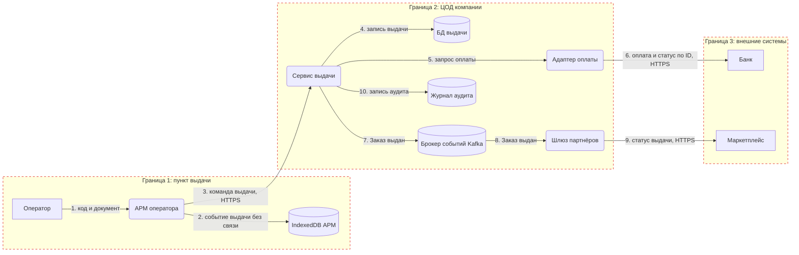

# Модель угроз: выдача заказа с оплатой при получении

## 1. DFD

Прямоугольник — внешняя сущность, скруглённый — процесс, цилиндр — хранилище, красный пунктир — граница доверия.

Через границы доверия проходят потоки 3, 6 и 9, поэтому угрозы ищем прежде всего на них.

## 2. Реестр угроз (STRIDE)

Риск = вероятность × ущерб. Баллы: низкая/низкий = 1, средняя/средний = 2, высокая/высокий = 3. Произведение 6–9 — высокий риск, 3–4 — средний, 1–2 — низкий.

| ID | Элемент DFD | STRIDE | Сценарий | Риск | Решение и мера | Владелец | Статус |
|---|---|---|---|---|---|---|---|
| T-01 | Поток 3 | S | Продавец магазина выдаёт заказ с того же компьютера под учёткой оператора | Высокая × высокий = высокий | Снизить: вход через OIDC со вторым фактором, у каждого своя учётка, АРМ блокируется после 5 мин простоя | Платформа | Запланировано |
| T-02 | Поток 3 | T | В запросе подменяют статус оплаты или сумму, и заказ уходит без оплаты | Средняя × высокий = высокий | Снизить: сумму берём из заказа, а статус оплаты сервис выдачи получает только от адаптера оплаты (ADR-007) | Выдача | Запланировано |
| T-03 | Сервис выдачи | E | Оператор через API вызывает операцию старшего смены, например оформление возврата или закрытие смены | Средняя × высокий = высокий | Снизить: права проверяются на сервере по матрице доступа | Выдача | Запланировано |
| T-04 | БД выдачи | T, R | Выдачу правят задним числом, чтобы скрыть недостачу | Средняя × высокий = высокий | Снизить: записи только добавляются, ошибку оформляем возвратом с причиной, у сервиса нет UPDATE и DELETE, всё пишется в аудит | Выдача | Запланировано |
| T-05 | Сервис выдачи | D | Касса магазина забивает общий канал связи, и выдача останавливается | Средняя × средний = средний | Снизить: лимит запросов на точку и приоритет трафика ПВЗ | Платформа | Запланировано |
| T-06 | Адаптер оплаты | I | Ключ API банка утекает из конфига или репозитория | Средняя × высокий = высокий | Снизить: ключ лежит в хранилище секретов, регулярно меняется, репозиторий сканируется в CI | Платформа | Запланировано |
| T-07 | Журнал аудита, логи | I | ПДн получателя (ФИО, телефон, документ) попадают в журнал и логи | Средняя × средний = средний | Избежать: номер документа не храним, записываем только факт проверки. Телефон маскируем, токены не логируем | Платформа | Запланировано |
| T-08 | Поток 9 | D | Маркетплейс недоступен, статус выдачи до него не доходит, и он считает заказ невыданным | Средняя × высокий = высокий | Снизить: событие хранится в Kafka, шлюз партнёров повторяет отправку до подтверждения (ADR-003) | Партнёры | Запланировано |
