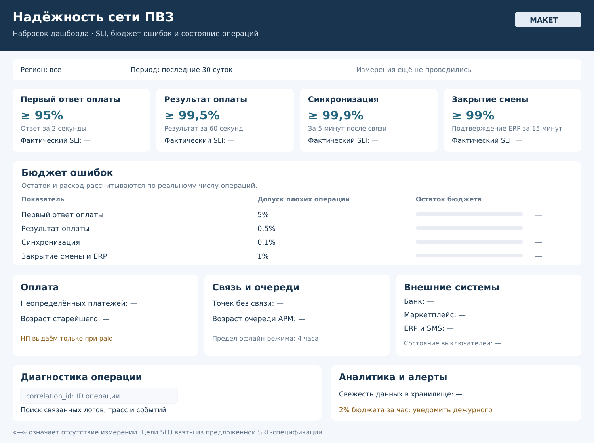

# Надёжность, наблюдаемость и восстановление сети ПВЗ

Статус: предложено.

Документ описывает, как измерять надёжность системы, находить проблемы и продолжать работу при сбоях.

## 1. SLI и SLO

SLI — показатель того, как система работает на самом деле.

SLO — целевое значение этого показателя.

Показатели оцениваются за последние 30 суток.

Из каталога E2E выбраны три пути:
- E2E-01 — оплата и выдача заказа с наложенным платежом;
- E2E-02 — предоплаченная выдача без связи и последующая синхронизация;
- E2E-03 — закрытие смены и передача итогов в ERP.

Для оплаты используются два показателя: скорость первого ответа и получение окончательного результата.

| Путь пользователя | Что считаем хорошим результатом | SLO за 30 суток |
|---|---|---|
| E2E-01: первый ответ оплаты | АРМ получил paid, declined или unknown не позже 2 с после первого нажатия «Оплатить» | Не менее 95%, по NFR-01 |
| E2E-01: результат оплаты | Подтверждённый результат paid или declined получен не позже 60 с после запуска | Не менее 99,5% |
| E2E-02: синхронизация | Сервер подтвердил сохранённую на точке выдачу не позже 5 мин после первого восстановления соединения с API | Не менее 99,9% |
| E2E-03: закрытие смены | Реестр и список расхождений сохранены, ERP подтвердила приём пакета не позже 15 мин после запроса закрытия | Не менее 99% |

### Правила подсчёта

- Повтор одной команды с прежним ключом не считается новой операцией.
- Отсчёт времени начинается с первой попытки.
- Ошибки нашей системы, таймауты и отказы внешних систем учитываются.
- Повторный обрыв связи не переносит начало срока синхронизации.
- Если операций не было, показываем N/A — показатель не рассчитан.
- Если данные наблюдения потеряны, показываем «данные неполны».

### Обязательные правила

Не допускаются:
- выдача заказа с НП без подтверждённого paid;
- новая оплата, пока результат предыдущей неизвестен;
- повторное списание или повторная выдача из-за дубля запроса;
- потеря сохранённого факта после восстановления связи.

## 2. Бюджет ошибок

Бюджет ошибок — допустимое число операций, которые не выполнили условия SLO.

### Пример расчёта

| Показатель | SLO | Число операций | Допустимо плохих операций |
|---|---:|---:|---:|
| Первый ответ оплаты | 95% | 200 000 | 10 000 |
| Результат оплаты | 99,5% | 200 000 | 1 000 |
| Синхронизация | 99,9% | 30 000 | 30 |
| Закрытие смены и ERP | 99% | 6 000 | 60 |

### Политика бюджета

| Остаток бюджета | Что делаем |
|---|---|
| Больше 50% | Выпускаем изменения в обычном темпе |
| От 25% до 50% включительно | Выпускаем осторожнее, устраняем причины последних сбоев |
| Больше 0%, но меньше 25% | Только необходимые исправления надёжности и безопасности |
| Бюджет исчерпан | Приостанавливаем новые функции и восстанавливаем надёжность |

Если изменение затрагивает несколько показателей, учитываем самое строгое ограничение.

Политику согласуют разработка, эксплуатация и продукт.

### Алерты по расходованию бюджета

Алерты - проблемы пользователей:
- операторы не могут выполнить выдачу;
- слишком много оплат остаются неизвестными;
- события долго ожидают отправки;
- ERP не принимает реестры.

Если бюджет расходуется медленно, но постоянно, создаём задачу владельцу сервиса.

В алерте указываем:
- какой показатель ухудшился;
- регион;
- сколько операций затронуто;
- сколько бюджета осталось;
- ссылку на дашборд.

## 3. Телеметрия и дашборд

Телеметрия — данные о работе системы.

Собираем три вида данных:

| Вид | Что показывает | Пример |
|---|---|---|
| Логи | Что произошло в отдельной операции | Банк не ответил за 1,5 с |
| Метрики | Численные показатели за период | Число unknown-платежей, доля ошибок, время ответа |
| Трассы | Путь одного запроса через сервисы | АРМ → Выдача → Оплата → Банк |

### Сбор данных

АРМ и сервисы передают данные через средства OpenTelemetry.

Собранные данные поступают в хранилища логов, метрик и трасс. Из них строятся дашборд и алерты.

Предусматриваем:
- время выполнения запросов;
- успешные и неуспешные операции;
- количество и возраст unknown-платежей;
- число точек без связи;
- возраст очереди;
- задержку обработки событий;
- состояние внешних систем;
- свежесть данных в аналитическом хранилище.

### Связь записей

correlation_id — общий ID одного бизнес-действия. Он сохраняется в связанных логах, событиях и аудите.

traceparent передаёт контекст трассировки между сервисами. По нему можно связать части одного запроса.

В логах сохраняем:
- время;
- сервис;
- событие;
- результат;
- correlation_id.

### Аудит

Аудит хранится отдельно от обычных логов.

В нём фиксируются:
- кто выполнил действие;
- что произошло;
- когда;
- на какой точке;
- результат и причина;
- correlation_id.

Отказ системы просмотра логов не должен останавливать выдачу.

Записи аудита должны сохраняться надёжно. Если нельзя сохранить необходимую запись аудита, значимое действие не завершается.

### Набросок дашборда

## 4. Устойчивость связей C2

Для каждой связи задаём время ожидания, правила повторов и защиту от отказов.

Эти меры нужно показать на соответствующих стрелках C2.

| Связь | Защита |
|---|---|
| АРМ → Сервис выдачи | Таймаут 2,5 с; до 3 повторов с прежним ключом; событие хранится на точке до подтверждения |
| АРМ → Сервис приёмки | Таймаут 2,5 с; повторы с прежним ID; допустимые действия без связи сохраняются локально |
| Сервис выдачи → Адаптер оплаты | Таймаут 1,8 с; повторов на этом уровне нет; отдельные ресурсы и Circuit Breaker |
| Адаптер оплаты → Банк | Таймаут 1,5 с; Circuit Breaker; после таймаута только проверка прежней операции |
| Партнёры → Маркетплейс | Таймаут 5 с; очередь, повторы с растущими паузами; автоматические попытки до 24 ч |
| Маркетплейс → Партнёры | Ограничение частоты запросов, проверка данных и защита от дублей |
| Сверка → ERP | Таймаут 5 с; очередь, повторы с паузами; один пакет на shift_id |
| ERP → Справочник точек | Проверка файла, формата, версии и дублей; ошибочный файл передаётся на разбор |
| Уведомления → SMS-шлюз | Таймаут 3 с; отдельные ресурсы и Circuit Breaker; повторы только пока код действителен |

Новые таймауты и пороги — предложения для проверки.

### Неизвестная оплата

Таймаут не доказывает, что банк не списал деньги.

Поэтому:
- новое списание запрещено;
- выдача НП заблокирована;
- проверяется результат прежней операции.

Опрос статуса вместе с паузами ограничен 60 с от запуска. Если следующая попытка не помещается в этот срок, её пропускаем.

Если результат остался unknown, операция передаётся на разбор. Она не объявляется автоматически отклонённой.

### Circuit Breaker — выключатель

Выключатель временно прекращает вызовы проблемной системы.

Предлагаемые настройки:
- считаем ошибки за 30 с;
- решение принимается после минимум 20 вызовов;
- при 50% и более технических ошибок делаем паузу 30 с;
- затем разрешаем несколько пробных запросов.

Если пробы успешны, возвращаем обычную работу.
Если ошибки продолжаются, снова делаем паузу.

Банковский declined не считается технической ошибкой.
Проверка восстановления банка не должна создавать тестовые списания.

### Другие меры защиты

- Bulkhead — отдельные ресурсы для банка, ERP и SMS. Зависшая ERP не должна занять ресурсы выдачи.
- Rate Limiting — ограничение частоты запросов на точку и партнёра.
- Load Shedding — при перегрузе сначала ограничиваем отчёты и аналитику.
- Outbox — запись операции и подготовленное событие сохраняются одной транзакцией.
- Дедупликация — потребитель проверяет event_id и не учитывает событие повторно.
- DLQ — сообщения с ошибками сохраняются в отдельной очереди до разбора.

После 24 ч неуспешной доставки создаётся инцидент. Неотправленные данные не удаляются.

## 5. Плавная деградация

Плавная деградация — сохранение части функций при отказе других.

| Отказ | Что продолжает работать | Что ограничивается |
|---|---|---|
| Банк | Приёмка, поиск, предоплаченные заказы | Новая выдача НП запрещена; unknown нельзя оплатить заново |
| Адаптер оплаты | Приёмка, поиск, предоплаченные заказы | Новая оплата временно недоступна |
| Связь точки с ЦОД | До 4 ч — предусмотренные действия по локальным данным | НП запрещён; события ожидают синхронизации |
| Маркетплейс | Работа с уже принятыми заказами | Статусы ожидают отправки |
| ERP | Работа ПВЗ и формирование реестра | Выгрузка ожидает; финансовая сверка не объявляется подтверждённой |
| SMS-шлюз | Выдача по уже доставленному действительному коду | Без допустимой проверки получателя выдача запрещена |
| Аналитическое хранилище и BI | Оплата, выдача, оперативная сверка | Отчёты недоступны или устарели |
| Kafka | Допустимые операции сохраняются в БД и Outbox, пока есть место | Передача событий потребителям задерживается |
| Журнал аудита | Действия с надёжно сохранённой исходной записью аудита | Если запись сохранить нельзя, значимое действие блокируется |

### Работа без связи

Для предоплаченной выдачи по E2E-02 нужны:
- проверенная и защищённая от изменения локальная копия данных заказа;
- подтверждённая предоплата;
- допустимый способ проверки получателя;
- право оператора работать в ограниченном офлайн-режиме;
- возможность сохранить факт выдачи на точке.

Без этих условий доступны только приём и поиск.

После 4 ч новые офлайн-выдачи останавливаются.
Уже сохранённые факты должны быть отправлены после восстановления связи.

## 6. Аварийное восстановление — DR

DR — восстановление после серьёзного отказа, например потери ЦОД.

RTO — за какое время нужно восстановить работу.

RPO — какой объём последних данных допустимо потерять.

Выбираем тёплый резерв во втором ЦОД: заранее подготовленные сервисы, сеть и копии данных.

Таблица относится к потере основного ЦОД при исправном независимом резерве.

| Компонент | RTO | RPO |
|---|---|---|
| Выдача и Оплата, их БД | 30 мин | 0 подтверждённых записей |
| Приёмка и Сверка, их БД | 60 мин | 0 подтверждённых записей |
| Kafka | 60 мин | До 1 мин данных в резервной копии Kafka; недостающие бизнес-события восстанавливаются из Outbox |
| Журнал аудита | 4 ч | 0 исходных фактов аудита |
| Справочник точек | 4 ч | 24 ч |
| Аналитическое хранилище и BI | 24 ч | 24 ч сохранённой копии |

Для восстановления событий необходимо сохранять исходный Outbox и записи о ранее обработанных event_id.

### Сохранность критичных записей

Для RPO 0 критичная запись подтверждается только после её сохранения на удалённой синхронной реплике.

Если такой резерв недоступен, нельзя подтверждать критичные записи только локально: иначе при потере основного ЦОД они могут исчезнуть.

Это решение нужно проверить вместе с требованием времени ответа оплаты.

### Порядок восстановления

1. Подтвердить отказ и ограничить недоступные операции.
2. Запретить запись на прежней площадке.
3. Проверить резервные БД, конфигурации и доступы.
4. Разрешить запись только на одной выбранной площадке.
5. Восстановить сервисы и проверить состояние платежей по прежним ключам.
6. Повторно доставить сохранённые события с прежними event_id.
7. Сверить выдачи, платежи, суммы и аудит.
8. После проверки возобновить операции.

Восстановление не должно создавать новые платёжные ключи и повторные списания.

### Резервные копии

Предлагаем:
- ежедневно создавать полную копию БД;
- непрерывно сохранять WAL — журнал изменений БД;
- размещать копии отдельно от основной площадки;
- проверять их целостность и доступность.

Реплика может повторить ошибочное удаление данных.

Поэтому при таком повреждении восстанавливаем БД из копии и журнала на безопасный момент перед ошибкой, затем выполняем сверку.

### Проверка восстановления

Раз в месяц проверяем восстановление выбранной БД из копии.

Раз в три месяца проверяем переключение на резервную площадку.

Измеряем:
- время восстановления;
- сохранность подтверждённых записей;
- отсутствие повторных списаний и выдач;
- правильность сумм;
- доступность аудита.

Выбор стратегии описан в [ADR-008](../adr/ADR-008-disaster-recovery.md).
